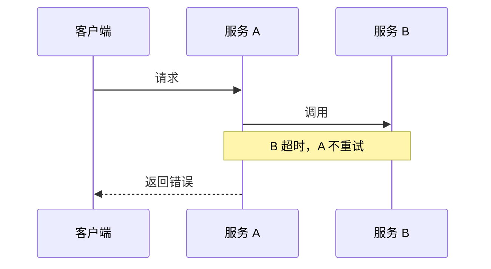

# Karpathy 输出表达建议与现有 skills 的融合研究

初稿：2026-10-08；深入补充：2026-10-09。性质：调研与改进建议，未修改或安装 skill，未形成正式方案审批。

## 结论

可以引入，优先改进中文表达的语义保真、按理解任务选择输出形式、图文与证据的一致性。现有系统已经有清晰写作、Mermaid 路由、读者测试和离线 HTML，新增价值主要来自跨技能复用与补充验证。建议先选两个诊断场景试点，视频留给明确的教学请求。

GitHub 上确实已有明确引用这段发言的实现。值得分别借鉴：`ifrit98/Explainer` 的解释与事实分离、`FutureAtoms/karpathy-ladder` 的形式选择与页面检查，以及更早的中文写作、英文 STE 和 HTML 渲染项目。没有发现证据足以支持“完整安装某个项目即可普遍提升现有技能效果”。

10 月 9 日补查后，累计核对 14 个项目，13 个取得提交快照；阅读深度按下文记录，不代表逐个完整运行。新增发现是：轻量规则值得试验，但“一句提示与完整 skill 效果相当”的泛化说法不成立；其项目自己的全模型评测未达到预设标准。另有项目更贴近中文工程解释，但强制类比、标签和升级提示与你的约定存在冲突。

建议直接阅读下文“2026-10-09 深入补充”：其中包含对原帖的解释、新项目比较、评测源码核对、具体规则草案和三组改写示例。前面的本地能力盘点与初轮研究保留，供追溯。

## 初轮研究范围与证据强度

本地基线为 `92953f1f46ba47078716f555b098de78bec3f0e3`，开始时工作区无改动。枚举仓库内 48 个 `SKILL.md`，检索其输出规则，重点阅读写作、方案图示、读者测试、调用拓扑、告警、日志、JVM 和评测相关内容；没有逐项运行全部技能。另核对当前会话的 `visualize` 插件入口规则，用于判断重复能力。

初轮外部检索使用 Karpathy、ASD-STE100、explainer、skill 等组合，核对 8 个仓库。7 个仓库通过 GitHub API 获取了提交身份并抽查源码；Fenng 项目当时通过 GitHub 文件页与发布说明阅读，未获取 HEAD。10 月 9 日的扩展范围另见补充章节。搜索发现不等于全网穷尽，仓库名或星数也不等于效果证据。

用户提供的原文作为研究起点。[原帖链接](https://x.com/karpathy/status/2105819303471976479)初轮未能读取，ASD 官网当时亦未成功读取。因此不声称独立核验了原帖时间或官方标准全文；10 月 9 日通过搜索索引补读官方介绍，仍未核对标准全文。关于直接受启发关系，以项目自身 README 或技能入口的明确说明为依据。

## 你已经具备哪些能力

| 能力 | 本地证据 | 本次建议 |
|---|---|---|
| 简洁表达与术语一致 | [writing-principles.md](/home/joney/projects/ai/agent-tools/skills/dev-workflow/references/writing-principles.md:11) 已要求明确参与者、动作、对象和条件，一个概念一个名字 | 补充改写时保护确定程度、授权强度、数字、单位和默认值 |
| 按内容选择图型 | [visualization-routing.md](/home/joney/projects/ai/agent-tools/skills/dev-workflow/dev-design-solution/references/visualization-routing.md:5) 已区分时序、状态、关系、分支和表格 | 保留现有规则；补充何时需要交互，不另建一套图型分类 |
| 分层阅读 | [readability-and-writing.md](/home/joney/projects/ai/agent-tools/skills/dev-workflow/dev-design-solution/references/readability-and-writing.md:5) 已有摘要、机制理解、实现参考三个层次 | 将适用原则推广到复杂诊断报告，不复制正式方案的全部模板 |
| 实际读者检查 | [reader-test-protocol.md](/home/joney/projects/ai/agent-tools/skills/dev-workflow/dev-design-solution/references/reader-test-protocol.md:39) 已考虑强模型答题饱和，并区分全文、截断与人的测试 | 增加图文转换后的遗漏检查；普通查询不强制运行读者测试 |
| 离线交互报告 | [inspect-app-call-topology/SKILL.md](/home/joney/projects/ai/agent-tools/skills/lexin/inspect-app-call-topology/SKILL.md:40) 已规定一份主报告、HTML/Markdown 按需选择 | 以此为本地先例，扩展到真正需要时间线或筛选的诊断任务 |

调用拓扑脚本已经把查询结果组织为数据模型，并将 JSON 与 PromQL 嵌入报告：[inspect_call_topology.js](/home/joney/projects/ai/agent-tools/skills/lexin/inspect-app-call-topology/scripts/inspect_call_topology.js:874)。这比从空白开始编写通用“解释系统”更贴合你的使用场景。它也明确区分缺数据、归属未知、统计近似与真实异常，新增展示规则应继承这些语义。

当前可见的改进空间集中在输出端。告警技能按“画像→逐层证据→结论→动作”组织报告：[diagnose-healthy-alert/SKILL.md](/home/joney/projects/ai/agent-tools/skills/lexin/diagnose-healthy-alert/SKILL.md:193)；JVM 技能主要列举应说明的指标：[inspect-healthy-jvm-dashboard/SKILL.md](/home/joney/projects/ai/agent-tools/skills/lexin/inspect-healthy-jvm-dashboard/SKILL.md:79)。二者适合试点更直接的结论入口和有条件的时间线展示。

## GitHub 候选与取舍

### 明确引用本次发言的项目

| 项目 | 已确认内容 | 建议 |
|---|---|---|
| [ifrit98/Explainer](https://github.com/ifrit98/Explainer) | README 明确说明由该发言启发，覆盖文字、图、交互页面、视频 | 重点借鉴，按机制吸收 |
| [FutureAtoms/karpathy-ladder](https://github.com/FutureAtoms/karpathy-ladder) | README 明确引用原帖，提供输出选择和本地检查器 | 借鉴路由与功能检查，过滤审美限制 |
| [zichuanxu/andrej-karpathy-skills](https://github.com/zichuanxu/andrej-karpathy-skills) | 在四项编码原则之外增加“Explain for Understanding” | 用作短原则的措辞参考，与你已有全局规则高度重叠 |
| [mzopedia/simplified-technical-chinese](https://github.com/mzopedia/simplified-technical-chinese) | README 明确引用发言，将 STE 方法转为中文规则和检查器 | 借鉴中文歧义分类，不直接启用全部硬规则 |

### 思路相关，不能据此认定由本次发言催生

| 项目 | 已确认内容 | 建议 |
|---|---|---|
| [danyuchn/asd-ste100-skill](https://github.com/danyuchn/asd-ste100-skill) | 英文受控改写、保留原意、结构 lint；API 显示创建于 2026-07-20 | 重点借鉴保真约束；英文检查器不直接套中文 |
| [nicobailon/visual-explainer](https://github.com/nicobailon/visual-explainer) | HTML 图解、diff 展示、事实核对、确定性 quick renderer；创建于 2026-02-16 | 重点借鉴渲染与检查机制，避免直接采用默认 HTML 策略 |
| [Fenng/Tech-Doc-Style-Chinese](https://github.com/Fenng/Tech-Doc-Style-Chinese) | 受控中文、事实保真、分层参考与文案检查；8 月发布记录已包含 STE 模块 | 中文写作首选参考，选择性融入现有规则 |
| [zushicat/simple-explainer](https://github.com/zushicat/simple-explainer) | 写作、SVG、网页分为三个技能，网页保留源文、零外部请求 | 借鉴内容与展示分离；本轮未在已读 README 中确认明确原帖归因 |

### 最值得吸收的具体机制

**英文 STE：先保留命题，再简化语言。** `danyuchn` 的技能明确保护可能性、范围限定和精度，允许为保留语义而不满足风格规则。其 README 也说明 lint 只做结构检查，不能验证重写是否保留原意。你可以把这条原则用于中文及 agent 指令；不要宣称因此通过官方 STE 合规检查。[固定版本 SKILL.md](https://github.com/danyuchn/asd-ste100-skill/blob/32511c6992ecb5f1971e46a2943f2e6adceedafe/SKILL.md)

**中文表达：保留边界，选择性约束句式。** Fenng 的受控中文模块区分操作文档与解释文字，保留条件、否定、因果和必要的组合动作，并避免把英文词典和句长规则机械搬到中文。它与你的现有写作规则相容度较高；其引号、称呼等项目风格仍应服从你本地约定。[受控中文模块](https://github.com/Fenng/Tech-Doc-Style-Chinese/blob/main/references/controlled-technical-chinese.md)、[2026-08 发布说明](https://github.com/Fenng/Tech-Doc-Style-Chinese/releases)

**解释产物：先有事实，再组织阅读路径。** Explainer 用事实模型保存数值、术语和待解释的主张，再选择表达形式。源码检查了主张标记是否存在、数值是否属于模型。可借鉴这种一致性检查，但标记存在不能证明解释正确；你已有的 `traceability.md` 和业务查询 JSON 可以承担事实来源，不必再添加第二套 `model.yaml`。[固定版本 explain 技能](https://github.com/ifrit98/Explainer/blob/7b82a2ebb7b83f93b0690998eb65d1d5bc84af1a/plugin/skills/explain/SKILL.md)、[模型检查代码](https://github.com/ifrit98/Explainer/blob/7b82a2ebb7b83f93b0690998eb65d1d5bc84af1a/explainer_kit/model.py)

Explainer 的评测文档还报告过一个反例：初版原则令普通回答明显变长。它随后将聊天和正式产物分开处理。该实验只有六个问题、单一模型评分，不能推广为已证明的生产收益；但支持在你这里显式评估“新增无用内容”和“规则带来的额外成本”。[项目评测说明](https://github.com/ifrit98/Explainer/blob/7b82a2ebb7b83f93b0690998eb65d1d5bc84af1a/docs/evals.md)

**HTML：让模型主要填写内容，复用确定性渲染。** visual-explainer 的 quick 模式接受 JSON，检查字段、枚举、表格列数和连线节点引用，再转义文本并输出 HTML。适合高频、结构稳定的报告。其 `/fact-check` 把页面主张回到源码逐项核验，也值得参考。[quick 说明](https://github.com/nicobailon/visual-explainer/blob/0cc6f15452c455a05fb7fceb036d0da31387c69c/plugins/visual-explainer/quick/README.md)、[渲染器](https://github.com/nicobailon/visual-explainer/blob/0cc6f15452c455a05fb7fceb036d0da31387c69c/plugins/visual-explainer/quick/render.mjs)、[事实核对命令](https://github.com/nicobailon/visual-explainer/blob/0cc6f15452c455a05fb7fceb036d0da31387c69c/plugins/visual-explainer/commands/fact-check.md)

**页面检查：检验是否能看、能用。** karpathy-ladder 的检查器检测多个宽度下的溢出、标签重叠、加载错误和外部请求。可复用检查思路，并接到你已有的浏览器能力上；无需为了这一点引入整套视频依赖。[页面检查器](https://github.com/FutureAtoms/karpathy-ladder/blob/07c70890b2fbd96eaf757fb103908c46623897b4/skills/legible-explainer/scripts/check_page.py)

**转换保真：格式变化不授权内容改写。** simple-explainer 的网页技能要求保留源文，并在合并、折叠或删减时说明内容去向。这对把已评审文档变为展示页很有用。你可以要求展示页绑定源文版本，让展示层的修改不能自动更新审批结论。[网页技能](https://github.com/zushicat/simple-explainer/blob/0b0cf6709d4eab35ce991ab43a30bb164cc4d722/skills/explainer-webpage/SKILL.md)

## 不宜直接照搬的地方

visual-explainer 当前默认生成 HTML，并在终端表格达到 4 行或 3 列时自动改用 HTML；其图示规则也优先手写 SVG。你的现有规则允许普通表格直接回复，方案图有 Mermaid/飞书兼容要求。直接全局安装容易增加触发竞争和无必要的文件。[固定版本入口规则](https://github.com/nicobailon/visual-explainer/blob/0cc6f15452c455a05fb7fceb036d0da31387c69c/plugins/visual-explainer/SKILL.md)

STC 的简明词表包含将模糊时长改为精确数字的示例，而同一技能后文又要求不添加原文没有的时限、不改变确定程度。使用时必须以后者为约束，不能机械替换。其脚本只做句法检查，README 明确没有阅读理解对照实验。中文句长和禁用词适合先作为提示，不能直接成为你现有技能的阻断条件。[固定版本 SKILL.md](https://github.com/mzopedia/simplified-technical-chinese/blob/90ad0f004b26d7a66e286980b5efaf4769ad8584/SKILL.md)、[README](https://github.com/mzopedia/simplified-technical-chinese/blob/90ad0f004b26d7a66e286980b5efaf4769ad8584/README.md)

karpathy-ladder 的页面检查器把部分审美偏好也设为错误，例如禁止特定换行样式、单边装饰和 emoji；同时允许 Google Fonts，默认结果目录没有自动清理逻辑。这些与“功能可用”“完全离线”和你的临时目录约定不同。建议只提取功能检查，并在本地指定任务目录或使用会自动清理的临时目录。[检查器源码](https://github.com/FutureAtoms/karpathy-ladder/blob/07c70890b2fbd96eaf757fb103908c46623897b4/skills/legible-explainer/scripts/check_page.py)

上述直接响应发言的几个项目创建于 2026-10-02 至 10-04，观察期很短。项目自述、源码实现、局部实测和真实使用收益属于不同证据层级；本轮不把它们混为成熟度认证。视频链路还涉及动画、配音、字幕和渲染环境，目前缺少你实际任务中的收益证据，优先级低于文字与图表。[Explainer 依赖说明](https://github.com/ifrit98/Explainer#requirements)

## 建议怎样融入当前 skills

### 1. 先保护语义，再减少文字

优先在现有 `skills/dev-workflow/references/writing-principles.md` 补充小段规则，全局 `AGENTS.global.md` 只保留跨任务的简短原则。不要把外部项目的整份提示词加入全局上下文。

可采用的原则草案：

> 简化表达时，保留原文的条件、否定范围、确定程度、授权要求、默认值、数字和单位。专业术语与代码标识保持准确。若短句会损失这些信息，保留较长表达。选择能帮助读者理解和核验的最简单形式；只有结构、比较、状态变化或交互探索确有收益时才生成图或页面。

这会同时改进给人看的报告与给 agent 的指令，但二者目的不同：报告减少阅读负担；指令要明确触发条件、动作、停止条件与证据。结构化协议、命令、JSON、ID 和审批枚举继续由原契约管理，不能经过自然语言润色改值。

### 2. 按读者的问题选择形式

| 读者需要做什么 | 默认形式 | 升级条件 |
|---|---|---|
| 确认一个值或一次操作结果 | 短回复或小表格 | 通常无需文件 |
| 理解调用顺序或状态转换 | Mermaid 与必要文字 | 图能减少在脑中记忆的关系 |
| 对比多实例、时间段或发布前后 | 单文件 HTML 或图表 | 确实需要筛选、缩放、切换对照 |
| 探索假设变化 | 本地交互示例 | 有可信计算规则，并明确哪些是模拟值 |
| 学习随时间展开的机制 | 动画或视频 | 用户明确需要教学演示，收益足以承担制作成本 |

已有明确格式要求时遵循用户要求。正式研发文档继续遵守阶段产物目录和审批身份约定；展示页只作为派生视图，绑定其来源。调用拓扑这类业务报告继续保持一份主报告，不强制再交付重复的 Markdown。

当前会话的 [visualize 插件](/home/joney/.codex/plugins/cache/openai-bundled/visualize/1.0.38/skills/visualize/SKILL.md:7) 已区分对话内交互、静态 Mermaid 与独立文件。可以在适合的客户端使用它，但跨 Claude/Codex 的技能仍需本地文件作为可移植交付方式。不要将当前客户端插件缓存路径写入共用技能。

### 3. 两个诊断技能先试点

| 本地位置 | 建议的最小改进 | 判断是否有效 |
|---|---|---|
| `diagnose-healthy-alert/SKILL.md` 的输出约束 | 先说明故障判断、影响、主要证据、下一步；多个事件存在顺序关系时才画时间线 | 读者能区分触发原因、根因假设和已验证事实 |
| `inspect-healthy-jvm-dashboard/SKILL.md` 的输出部分 | 多实例比较时用统一时间轴，明确单位、采样窗口、缺失点和聚合口径 | 读者不会把不同窗口、平均值和峰值混为一谈 |
| `dev-design-solution/references/visualization-routing.md` | 补充交互视图与权威正文的关系，保留现有图型规则 | 图文一致，关键失败条件仍能在权威正文定位 |
| `dev-design-solution/references/reader-test-protocol.md` | 在实际使用派生图页的场景检查是否遗漏限定条件、增加无用内容 | 通过率不靠删除必要信息获得 |
| `evals/` 现有评测 | 补充形式选择和语义保真的小样本行为比较 | 简单请求不升级文件，复杂任务理解正确率不下降 |

先落在现有 owner 中。只有跨多个技能稳定出现相同渲染需求时，才考虑 `skills/common/` 下新增一个负责解释产物的 skill。其触发范围应限于复杂结果解释和已有证据的可视化，不接管普通查询、正式评审或完整网站开发。

### 4. 内容和展示分别验证

内容检查回答：结论是否有证据，环境和时间窗是否一致，单位是否正确，未知是否仍为未知，推测是否仍标为推测。图上的每条边和因果箭头也是主张，必须有来源支持。

展示检查回答：关键文字是否可见，筛选是否只改变视图，表格与图使用的数据是否相同，页面能否离线打开，是否出现脚本错误或标签遮挡。诊断页面只展示已采集数据；点击筛选不应隐式发起新查询、扩大排查范围或执行修复。

确定性检查适合验证数值、字段和来源版本；它不能独立证明因果关系。复杂解释可复用现有读者测试，普通查询保持轻量。现有行为评测的 `kind: execution` 尚未实现，真实工具轨迹与浏览器效果不能假装由目前的 dialogue runner 完整覆盖：[evals/README.md](/home/joney/projects/ai/agent-tools/evals/README.md:30)。

## 结合现有场景的示例

以下为表达示例，不是本轮查询到的线上结论。

原文：“该应用可能由于下游服务响应延迟而出现线程池资源持续被占用的问题，进而导致部分调用发生超时。”

可简化为：“一种可能的原因是：下游响应变慢，线程池资源持续被占用，部分调用因此超时。”这仍是假设，不能改成确定根因。若要进一步写出日志时间、线程栈结果或缺失的证据，需先实际核对，不能为使解释完整而补造。

如果有指标时间序列，页面可在同一时间轴展示响应耗时、活跃线程和超时数，同时展示窗口与来源。没有线程栈时，页面仍保留“尚未确认根因”，不会因三条曲线同时变化就自动画成确定的因果链。

授权指令也要保真。例如“预发布只保存草稿；stable 保存后按 key 发布”必须保留环境分支和发布范围。缩成“保存后发布配置”虽然更短，却改变了执行权限。这类条件比句长重要。

## 如何证明改进有效

建议用同一批脱敏材料做改动前后比较，先覆盖小查询、告警诊断、JVM 对比、方案理解四类任务。此处是研究建议，不是已执行的正式测试清单。

先记录不可退步的结果：授权条件、环境、单位、否定范围和不确定性不能丢；查询未完成不能写成无异常；空数据不能显示为健康。随后比较读者回答关键问题的正确率、定位证据所需时间、生成耗时、token 与额外文件数量。

模型评分可辅助找遗漏和冗余，实际阅读时间需要人测。图页效果通过后再扩大范围，不以“生成了更多图”或“文字更短”作为成功标准。任何句长、图数量或美观评分都只能辅助判断。

最小实施顺序建议为：补充保真规则，明确形式选择，改两个试点技能，再比较真实输出。若结构稳定且使用频繁，再从现有拓扑渲染方式与外部 quick renderer 中提取少量可复用组件。视频能力独立考虑，不放入诊断默认流程。

实施时遵循仓库已有技能版本、frontmatter、双端安装和评测约定；修改 `description` 才触发对应路由评测。共享审批契约如未改变，不为表达改进重建一套审批流程。

## 2026-10-09 深入补充

### 如何理解原帖：把理解和核验的成本算进交付成本

根据用户提供的原文，我的理解是：agent 承担更多执行工作后，人需要花更多精力判断它做了什么、为什么这样做、还有什么没被证明。解释能力因此成为交付质量的一部分。只交大量日志、长篇报告或代码，会把整理关系的工作留给读者。

四种形式分别帮助读者处理不同的问题：受控文字减少句子和术语的歧义；图把关系放到同一个可见空间；交互页面让读者改变输入、比较场景；动画让过程按顺序展开。这是对原文的工程化解读，不是已经获得实验证明的普遍效果排序。

“But even better”不宜落实成每次都升级到视频的策略。查一个配置值时，短回复方便复制和核验；比较十台实例时，筛选表格可能有效；理解重试和退避时，可逐步演示；故障值班时，视频却可能增加定位某个时间点的成本。应选择能让当前读者更快做出正确判断的形式。

可以用一个定性模型帮助取舍：总成本包括生成等待、阅读理解、证据核对，以及误解引起的返工。这个模型没有经过本轮量化验证。它提醒我们同时观察人的时间与模型成本，不能只优化字数、token 或视觉效果。

“80% STE”表达的是适度采用其写作约束，不是可测量的合规百分比。官方页面列出的版本是 Issue 9（2025-01-15），包含写作规则和词典，并允许领域术语。官方还明确提醒：AI 文字看起来清楚，不等于正确应用了标准。本轮通过搜索索引读取了官方页面内容；直接打开首页和 PDF 仍返回 403，未逐条核验标准全文。[官方介绍](https://www.asd-ste100.org/about_STE.html)、[官方 AI 与 STE 说明](https://asd-ste100.org/STE_downloads.html)

因此，你的中文 skills 应采用“中文清晰表达 + 语义保真”，不宜标为“中文 ASD-STE100 合规”。用户附图适合作为概览，不能替代正式规则或词典。

### 新项目中哪些值得参考

| 项目 | 这次核对的机制 | 对你的采用建议 |
|---|---|---|
| [whoislewys/SimplerEnglish](https://github.com/whoislewys/SimplerEnglish) | 一句正文的 skill；公开 A/B 结果、生成脚本、评分提示、正则检查器与场景 | 借鉴短规则与长规则对比的方法；不能照搬“效果相同”的宣传结论 |
| [AminBlg/SimpleEnglish](https://github.com/AminBlg/SimpleEnglish) | 上述 fork 的来源；当前 README 区分普通易读模式与严格 STE | 本轮只核对项目页面；不能把 fork 的旧版本实验当作当前上游效果 |
| [ashryaagr/karpathy-output-style](https://github.com/ashryaagr/karpathy-output-style) | 写作、图、网页、视频拆开；网页按教学需要添加交互，检查键盘操作和窄屏；严格 STE 需核对官方材料 | 适合借鉴条件加载与可用性要求；无需整体安装四个重叠技能 |
| [prithivrajmu/asd-ste100](https://github.com/prithivrajmu/asd-ste100) | 默认较轻的 STE；保留事实、可能性、代码；HTML/视频按用户要求生成 | 适合作为简短原则参考；英文句长不直接迁移，严格合规不能只靠模型记忆 |
| [bowen31337/comprehension-ladder](https://github.com/bowen31337/comprehension-ladder) | 转换前整理主张、机制和不确定性；图、页、视频延续同一份语义；提供六个评测场景 | 借鉴格式转换保真；其自定义严格度百分比、强制文件和末尾升级菜单不采用 |
| [bounce12340/karpathy-explain-skill](https://github.com/bounce12340/karpathy-explain-skill) | 面向工程师分层解释；简短模式；图文保留未知；类比要说明失效点 | 对中文工程解释较贴近；无需固定每次类比、每个结论加标签或设置中文字数硬上限 |

这些是非官方社区实现。后三个及 ashryaagr 的入口或项目页明确提到这段发言；SimpleEnglish 系列早于本次帖子。Fenng 的受控中文模块这次成功固定版本并读到源码与 MIT 许可，仍是与你现有表达规则较相容的参考。

bounce12340 声称写作规则来自 10 个会话、218 条回复，但没有宣称测得理解用时改善。本轮仅阅读技能及写作参考，未核查这些私人会话，也未运行其验证器。它给了有用的写作经验，不能作为对你实际使用效果的证明。[固定版本入口](https://github.com/bounce12340/karpathy-explain-skill/blob/183ff2db8b4616df061a90068ad07127b5a1986f/skills/karpathy-explain/SKILL.md)

### “一句提示就够了”的评测究竟证明了什么

SimplerEnglish 的公开实验是六个 Claude 模型、八个英文任务、三个条件，每个组合生成一次，共 144 次。条件分别是不加 skill、完整 skill、单句正文 skill。平均机械违规降幅为 86.1% 和 78.6%，相差 7.5 个百分点；项目预先规定差距应在 5 个百分点内，结果明确写为未达标。部分模型的结果更接近，不能据此推广到所有模型或中文。[固定版本结果](https://github.com/whoislewys/SimplerEnglish/blob/a641c82e6ab7e12528c7c8651cbb77e974103130/evals/results/ab-2026-08-14/RESULTS.md)

“便宜约 58%”来自该实验 CLI 报告的平均美元费用：完整 skill 为每项 0.1108 美元，短版为 0.0469 美元；它不是仅由 skill 字数推算，也不是你的运行成本预测。完整正文 token 数使用字符数除以四估计；实际生成函数读入整个 SKILL 文件，包括 frontmatter。因此“一句话”准确地说是正文一句话，并不表示实际只发送这句话。[生成脚本](https://github.com/whoislewys/SimplerEnglish/blob/a641c82e6ab7e12528c7c8651cbb77e974103130/evals/run_bench.py#L100)

评分还有两个边界。正则检查器统计句长、禁用词等，不能判断解释是否为真。模型裁判只看到两份输出和可读性评分要求，没有收到原始场景或正确事实清单；它难以核查遗漏或补造。裁判也没有直接比较长版与短版，并且相同 baseline 与不同答案配对时获得了不同分数。结果中已披露这种对比效应。[评分代码](https://github.com/whoislewys/SimplerEnglish/blob/a641c82e6ab7e12528c7c8651cbb77e974103130/evals/run_bench.py#L467)

本轮对已完整阅读的 `ste_lint.py` 做了一个两句对照，直接调用其纯文本 `lint` 函数：

| 输入 | 违规数 | 语义 |
|---|---:|---|
| `The database might be slow.` | 1 | 数据库可能慢 |
| `The database is slow.` | 0 | 数据库确定慢 |

差异来自 `might` 被计入禁用情态词。这说明只优化该分数，存在通过改变确定程度获得更低分的路径；它不证明 skill 实际一定会这样改写。这个局部检查没有调用模型，也没有测试人的阅读理解。[检查器源码](https://github.com/whoislewys/SimplerEnglish/blob/a641c82e6ab7e12528c7c8651cbb77e974103130/evals/ste_lint.py)

这项研究对你的实用启发是：先比较少量有针对性的规则，不直接搬入数千 token 的标准摘要；评价时先保护事实和行动边界，再比较可读性。示例库中部分事故场景原本就提供了精确时间和比例，不能只看 README 前后文本，就判定这些数字是改写时编造的。[评测输入](https://github.com/whoislewys/SimplerEnglish/blob/a641c82e6ab7e12528c7c8651cbb77e974103130/evals/scenarios.json)

### 把建议落到哪些文件

你现有 `writing-principles.md` 已覆盖简洁句式、术语、第一屏、证据分层。主要缺口是这些能力集中在研发文档；业务诊断的模板仍容易按照查询过程或指标清单展开。只新增一个自动触发的写作 skill，不能保证这些原有模板随之改变。

| 位置 | 建议最小增量 | 预期观察 |
|---|---|---|
| `AGENTS.global.md` 的最终回复约定 | 补充保护语义和按理解任务选择形式的短原则 | 普通对话与业务技能都能继承；不依赖额外 skill 恰好触发 |
| `skills/dev-workflow/references/writing-principles.md` | 在现有规则中补充条件、否定、可能性、单位、范围保护，以及摘要与证据的一致性 | 正式文档更容易核验，既有身份和字段不变 |
| `skills/lexin/diagnose-healthy-alert/SKILL.md:193` | 复杂报告先给判断、影响范围和关键证据缺口，再展开画像、证据、建议 | 第一屏就能知道是否故障、结论有多确定 |
| `skills/lexin/inspect-healthy-jvm-dashboard/SKILL.md:79` | 按请求区分看板解释与健康巡检；后者先给异常实例、时间窗、影响和未知 | 避免健康问题先得到看板元数据清单 |
| `evals/` 与已有读者测试 | 比较原规则、短增量、短增量加按需图示；单独检查语义与形式选择 | 能区分收益来自写作、图示还是仅增加篇幅 |

日志查询技能已经明确范围、截断、证据和下一步，可作为对照样本，不必一开始改动。调用拓扑已经有离线交互报告，优先复用其已存在的数据与展示关系。正式方案图继续使用现有 Mermaid 路由。

以下是拟议的全局增量文字，尚未写入配置；最终整合时应合并到现有条款，避免原句重复：

> 简化说明时，保留条件、否定、确定程度、环境、时间范围、数字、单位、授权要求及失败处理。保留命令、标识符和协议字段的准确值。摘要、图和页面不得增加原始证据不支持的结论。
>
> 按读者要完成的判断选择形式。短结果直接回复；比较用表格；关系、时序和状态变化在图示有帮助时画图；需要筛选或改变参数时使用交互页面。已有格式要求优先。只有存在相应讲解需求时才制作视频。

告警和 JVM 的具体输出顺序属于各自 skill。不要把所有任务统一规定为五段报告，也不要为了展示证据而给每句话增加“已确认／推论／未知”标签。可以用自然句明确区分：“日志显示……”“这支持……的判断”“还缺……，无法确认……”。

若以后多个业务技能需要较长的共同规则，再建立一份由相关技能明确引用的共享参考。仅在 `references/` 中新增文件而没有读取入口，不会可靠地影响输出。

### 三组中文示例：以读者的判断为入口

以下全部为合成示例，用于说明拟议行为；数字、时间和故障都不是实际环境查询结果。每组改写只使用该组已给出的事实。

#### 例一：操作成功，同时保留发布边界

输入事实：预发布环境，`app-a` 的 `timeoutMs` 从 1000 改为 2000；已保存草稿，回读值一致，未发布。

不理想的汇报：“已完成相关配置项的调整和校验，整体符合预期，后续可按需处理。”

建议汇报：“已在预发布为 `app-a` 保存配置草稿：`timeoutMs` 从 1000 改为 2000。回读值一致；草稿尚未发布。”

读者可以直接确认对象、变化和当前状态。“符合预期”被可核验事实替代；不因追求简短把“草稿保存成功”写成“配置已生效”。此处无需图、页面或额外建议。

#### 例二：查询为空，但证据范围有限

输入事实：线上应用 A，10:00—10:10（北京时间），共五台实例，只查到两台；两台未检出 ERROR，其余三台查询失败。

不理想的汇报：“暂未发现异常，建议持续观察。”

建议汇报：“本次查询不足以判断应用 A 是否正常。线上五台实例中，两台在北京时间 10:00—10:10 未检出 ERROR，其余三台查询失败。下一步先补查这三台。”

第一句给出明确判断，后面紧跟其范围。不把“已查询部分未检出”扩展为“全部健康”。一句“暂未发现异常”即使很短，也会增加误解。

#### 例三：将机制改为时序图，保留失败条件

输入事实：客户端请求服务 A，A 调用 B；B 超时后 A 不重试，直接向客户端返回错误。

建议正文：“B 超时后，A 直接返回错误。本次请求没有重试。”如果读者需要理解参与者之间的交互，再补图：

图没有把“未收到响应”画成“B 发回一个超时消息”，也没有为讲得完整而补造超时时长、错误码或重试次数。三个参与者并不自动意味着必须有图：只需确认是否重试时，上面两句话已经足够。这是说明性 Mermaid 源码，本轮未执行渲染检查。

### 采用顺序与效果验证

建议第一批只做短规则增量和两个业务 skill 的输出调整。图示沿用现有能力，等出现反复需要的筛选或比较场景，再改进 HTML；当前没有足够证据支持增加默认视频流程。

可先选 12 份脱敏或合成材料：四份短结果、四份受限诊断、四份机制说明。这是低成本试点建议，不是统计显著性设计。保持原始证据、任务和模型配置一致，比较原规则、短增量、短增量加按需图示。出现明显差异时再重复相应样本，不必一开始扩大所有测试。

先核对必需信息是否保留：对象与环境、时间窗、单位、否定、条件、置信程度、授权范围。再让读者回答当前场景的关键问题，例如“确认了什么”“尚不能确认什么”“下一步为什么有用”“去哪里核对”；记录答对情况和定位证据用时。与此同时记录模型耗时、token 和额外文件数。可读性提高应体现为更少误解或更快理解，不能靠删掉必要事实获得。

模型可以辅助检查遗漏，但应拿到原始事实和待核对项。纯文字 lint、截图可读、页面可点击、模型喜欢某个答案，分别只支持局部结论。HTML 应实际打开并操作关键控件；视频应实际检查导出后的声音与画面。没有运行的环节，在交付时明确说明。

### 补充版本与验证记录

以下为 2026-10-09 获取的提交；未将第三方源码纳入正式仓库。

| 项目 | 固定提交 | 读取范围与许可 |
|---|---|---|
| whoislewys/SimplerEnglish | [a641c82e6ab7](https://github.com/whoislewys/SimplerEnglish/commit/a641c82e6ab7e12528c7c8651cbb77e974103130) | skill、评测结果、生成与 lint 代码、场景；API 识别 MIT |
| Fenng/Tech-Doc-Style-Chinese | [b119d01c9bb7](https://github.com/Fenng/Tech-Doc-Style-Chinese/commit/b119d01c9bb7cd132b3c62fafdff34227c4410d1) | 受控中文模块、LICENSE；MIT |
| prithivrajmu/asd-ste100 | [577fc0184c7e](https://github.com/prithivrajmu/asd-ste100/commit/577fc0184c7ed64a6d4e8c9005ca60bcf328eae5) | 主 skill；API 识别 MIT |
| ashryaagr/karpathy-output-style | [4f6c5e974ad8](https://github.com/ashryaagr/karpathy-output-style/commit/4f6c5e974ad8a41fb2ffd628de2ed5271f0b5d88) | 写作、网页、视频入口与 LICENSE；MIT，但明确排除附带第三方参考图片 |
| bowen31337/comprehension-ladder | [a65ce16d04cb](https://github.com/bowen31337/comprehension-ladder/commit/a65ce16d04cbdaea8bbac191fdb90ad193183e95) | 主 skill 与六个评测场景；API 识别 MIT，树中有单独上游许可 |
| bounce12340/karpathy-explain-skill | [183ff2db8b46](https://github.com/bounce12340/karpathy-explain-skill/commit/183ff2db8b4616df061a90068ad07127b5a1986f) | 主 skill 与写作参考；API 识别 MIT |

AminBlg 上游的 API 请求超时，未取得当前提交；只使用项目网页支持的描述。ashryaagr 的 `references/asd-ste100.md` 下载超时，因此没有采信其中可能包含的图片纠错。没有运行外部 LLM 评测、安装插件、生成视频或执行内网查询；这次新增运行验证仅为前述两句 lint 对照。

报告已人工核对新增结论与引用；10 处本地链接均存在，六份补充仓库快照的提交号均与报告一致，已检查 Markdown 代码围栏和空白。已删除本轮下载的 22 个临时文件及 `/tmp/agent-work/20261009-agent-output-readability/` 目录；可追溯证据保留为本报告中的固定版本链接和检查结果。

## 初轮版本与许可记录

下表为 2026-10-08 的 GitHub API 读取结果；星数仅帮助识别规模，不用于排序或证明质量。完整提交可通过链接追溯。

| 仓库 | 固定提交 | 创建时间 | 当时星数 | 许可观察 |
|---|---|---|---:|---|
| danyuchn/asd-ste100-skill | [32511c6992ec](https://github.com/danyuchn/asd-ste100-skill/commit/32511c6992ecb5f1971e46a2943f2e6adceedafe) | 2026-07-20 | 4033 | API 为 MIT |
| ifrit98/Explainer | [7b82a2ebb7b8](https://github.com/ifrit98/Explainer/commit/7b82a2ebb7b83f93b0690998eb65d1d5bc84af1a) | 2026-10-03 | 9 | API 为 MIT；视频依赖另有许可 |
| FutureAtoms/karpathy-ladder | [07c70890b2fb](https://github.com/FutureAtoms/karpathy-ladder/commit/07c70890b2fbd96eaf757fb103908c46623897b4) | 2026-10-03 | 6 | API 为 MIT |
| zichuanxu/andrej-karpathy-skills | [68340afef676](https://github.com/zichuanxu/andrej-karpathy-skills/commit/68340afef676f4e6eb38c05f9a30952821b40461) | 2026-10-02 | 0 | API 未识别；plugin manifest 标为 MIT，树中未见 LICENSE |
| mzopedia/simplified-technical-chinese | [90ad0f004b26](https://github.com/mzopedia/simplified-technical-chinese/commit/90ad0f004b26d7a66e286980b5efaf4769ad8584) | 2026-10-04 | 7 | README：规范与词表 CC BY 4.0，脚本与测试 MIT |
| nicobailon/visual-explainer | [0cc6f15452c4](https://github.com/nicobailon/visual-explainer/commit/0cc6f15452c455a05fb7fceb036d0da31387c69c) | 2026-02-16 | 10288 | API 为 MIT |
| zushicat/simple-explainer | [0b0cf6709d4e](https://github.com/zushicat/simple-explainer/commit/0b0cf6709d4eab35ce991ab43a30bb164cc4d722) | 2026-10-04 | 0 | API 未识别根项目许可；字体有单独许可文件 |

初轮对 Fenng 仅核对网页；10 月 9 日已补齐固定提交和 MIT 许可，见补充记录。未将外部代码纳入本地技能仓库或安装到客户端；后续直接复用源码时需保留对应许可与归属，API 未识别不能简单解释为没有许可或可任意复制。

## 初轮验证与限制

对 `visual-explainer` 固定版本的 `validateQuickSpec` 执行了 5 项局部检查：合法输入通过、未知字段拒绝、表格列数不匹配拒绝、连线引用不存在节点拒绝、非法风险枚举拒绝，结果 5/5。检查通过只支持这些 schema 行为，不证明事实正确或页面可读。

未执行完整插件安装、HTML 浏览器渲染、视频生成或真实用户 A/B 测试，未运行本地业务技能和生产查询。部分 GitHub Raw 请求出现 TLS 超时：英文 linter、Explainer verify 入口、karpathy-ladder benchmark、zichuanxu 主技能、STC 校准报告未成功下载；对这些内容不作源码实测声明，相关结论只采用明确已读的 README、其他源码或网页证据。

本轮只产出此研究报告与索引更新。报告已回读，本地引用路径全部存在，`git diff --check` 通过。下载的 21 个临时源码文件及 `/tmp/agent-work/20261008-karpathy-skills-research/` 任务目录已删除；持久证据保留为本报告中的提交身份、链接和验证结果。
