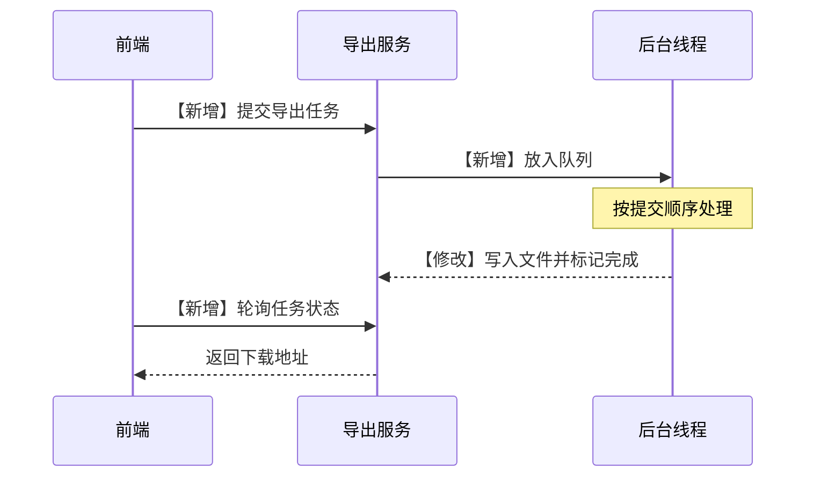
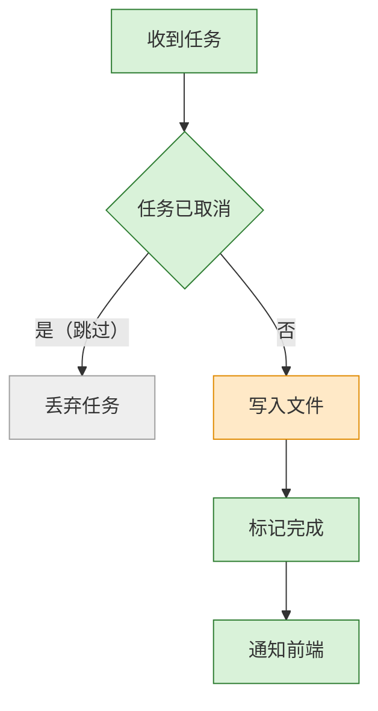
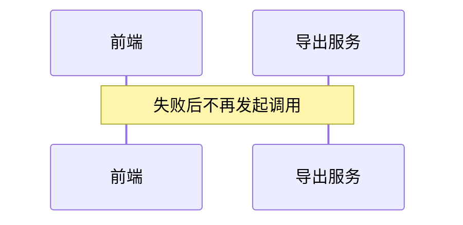

# 合成样例：订单导出改为异步任务

> 状态：Draft · 版本：v2 · 日期：2026-10-28 · 主 profile：mechanism-architecture

相关文档：无（本文件是 render_solution.mjs 的测试夹具，内容虚构）。

## 摘要

导出请求改为提交异步任务，前端轮询任务状态后下载文件。

## 1. 背景与目标

### 1.1 现状与问题

同步导出在数据量大时超时。

### 1.2 目标与非目标

| 类型 | 内容 |
|---|---|
| 目标 | 导出不超时 |
| 非目标 | 改变导出格式 |

### 1.3 约束、假设与术语

| 术语 | 含义 |
|---|---|
| 任务 | 一次导出请求 |

## 2. 方案概览

### 2.1 一句话方案与主图

提交任务、后台生成、轮询下载。

1. 前端提交导出任务，拿到任务 ID。
2. 导出服务把任务放进队列。
3. 后台线程写文件并把任务标记为完成。
4. 前端按任务 ID 轮询状态。
5. 完成后返回下载地址。

### 2.2 关键决策

| 决策 | 选择 | 理由 |
|---|---|---|
| DEC-001 | 轮询 | 不引入推送通道 |

### 2.3 为什么这样能成立

任务状态只有一个写入方。

### 2.4 变更总览

| 应用 | 对象 | 变更 | 改动内容 | 详见 |
|---|---|---|---|---|
| 导出服务 | 提交接口 | 新增 | 返回任务 ID | 3.1 |
| 导出服务 | 文件写入 | 修改 | 写完标记完成 | 3.2 |
| 前端 | 下载按钮 | 现有 | 不变 | — |

## 3. 详细设计

### 3.1 任务提交

提交接口只校验参数并入队。

### 3.2 任务执行

<!-- render: node-map 丢弃任务=取消处理 -->

| 步骤 | 变更 | 实现位置 |
|---|---|---|
| 收到任务 | 新增 | `ExportWorker.take()` |
| 任务已取消 | 新增 | `ExportWorker.isCancelled()` |
| 取消处理 | 现有 | `ExportWorker.drop()` |
| 写入文件 | 修改 | `ExportWriter.write()` |
| 标记完成 | 新增 | `ExportTask.complete()` |
| 通知前端 | 新增 | `ExportNotifier.push()` |

### 3.3 失败处理

写文件失败时任务标记为失败，前端停止轮询。

## 4. 替代方案与取舍

| 候选 | 不选的原因 |
|---|---|
| 推送通知 | 需要新增长连接 |

## 5. 影响与兼容

旧的同步接口保留一个版本。

## 6. 发布、验证与回滚

| 阶段 | 通过信号 | 回滚 |
|---|---|---|
| 1 | 大数据量导出成功 | 切回同步接口 |

## 7. 风险与未决问题

| 风险 | 缓解 |
|---|---|
| 队列积压 | 限制并发任务数 |
